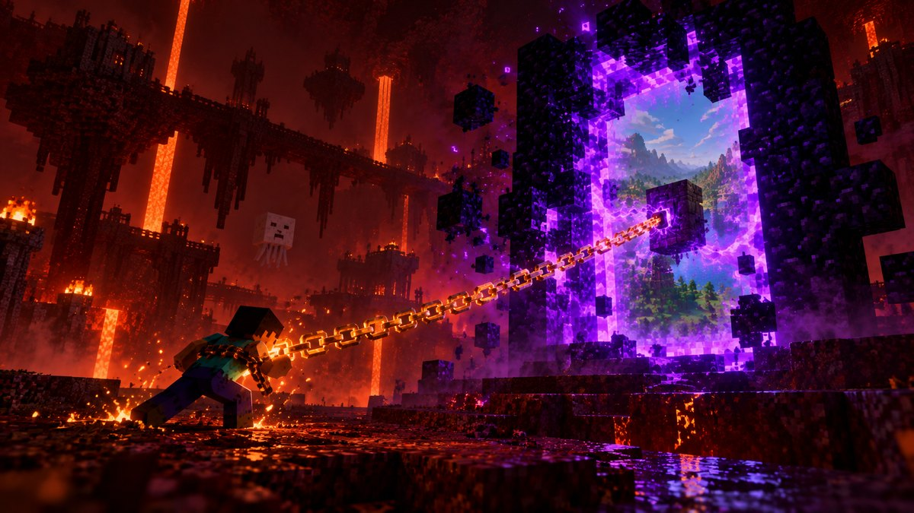

# Extreme Dimensions

*Every portal is a wound. Every wound remembers.*

A survival-horror overhaul of everything beyond the Overworld, for **Minecraft 26.3** on **Fabric**. The Nether and
the End become timed expeditions on a physical Tether; a fourth world, **the Seam**, waits behind a needle's tear; an
ancient tribe watches from the dark; four Elders, a Starved One and an ending that changes the world for good; and
after it, a tapestry you weave yourself.

---

## Getting started

1. Install **Fabric Loader 0.19.5+** for **Minecraft 26.3** (Java 25), with **Fabric API 0.162.0+**.
2. Put the mod's jar in your `mods` folder, on the server **and** on every client.
3. Play a normal Survival world. (Vanilla Hardcore makes you a spectator on death, which the mod is built to avoid.)

Your first day hands you the **Tether Journal**. Its first page, a guide card on the screen and the **Path** tab in
the journal walk you through the first expedition: charge an anchor, bind your Tether, step through, come home. A
word comes when you first stand by a portal or hold a lodestone, and a portal that will not let you through yet says
what is missing.

## The loop

1. **Charge an anchor.** A lodestone within 5 blocks of a portal, fed with fuel. Its first fuel binds it to that world:
   an **Ember Anchor** (Nether) or a **Void Anchor** (End). Each player stores up to 30 minutes per anchor.
2. **Bind your Tether** (iron chain + 2 string) to it. A real chain lies on the ground wherever you walk.
3. **Step through.** Your timer is the charge *you* stored, shown as a boss bar. It drains every second, faster the
   further you wander from the portal you came through.
4. **Come home** before it runs out. Or don't: at zero you suffer a **Collapse**, wake at home and pick one of three
   **curses**.

| Nether fuel | Charge | End fuel | Charge |
| --- | --- | --- | --- |
| Coal / Charcoal | 0:02 | Amethyst Shard | 0:03 |
| Magma Block | 0:06 | Chorus Fruit | 0:06 |
| Fire Charge | 0:12 | Ender Pearl | 0:20 |
| Blaze Powder | 0:15 | Eye of Ender | 0:45 |
| Coal Block | 0:18 | Shulker Shell | 1:30 |
| Breeze Rod | 0:30 | Echo Shard | 2:00 |
| **Ember Tether** | 10:00 | **Void Tether** | 10:00 |

Fuel values show in item tooltips.

## Curses, and lifting them

**92 curses in four sets**, each permanent and stacking to its own maximum: *Beyond the wound* (26, in the Nether, the
End and the Seam), *Overworld* (17, on unless an operator turns them off), *Everywhere* (16) and *Extreme* (9, cryptic,
heavy, and dearer to atone). Sometimes the offer is multiplied (2x to 4x); stacks that do not fit spill onto other
curses. Once every curse a death draws from is full, it draws from the other set, then the Extreme set, then the
Abyssal curses below. However many you carry, curses always leave you 3 hearts and 2 blocks of reach. The **Curses** screen (the button beside the journal in your inventory) shows them all.

Under the Extreme set lie the **24 Abyssal curses**, dealt on Hard and Extreme (an operator can switch them on for Easy
and Normal): one stack each, rare (at most one carried on Hard, two on Extreme, until every other curse is full), on
Extreme sometimes the only card on offer. Each has a **deed** that breaks it at
once (slay 30 undead in daylight, offer a Nether Star at an anchor, keep awake through three nights...); atonement
still works, at four times the cost, and a death takes all of it.

On **Hard** and **Extreme** a curse you have never carried shows only runes, on its card and in the Curses screen,
until you take it once; on Easy and Normal every curse reads from the start (the Extreme set only ever hints). The
runes are the **Seam script**, an alphabet of the mod's own: threads with knots, beads and loose ends tied into them.

A curse laid without a choice (a Lurker's touch, the swarm, a barter, a Collapse...) shows as a toast naming it and where
it came from, and the Curses screen keeps the newest along its top, marking those that came since you last looked.

Operators have the **Players** screen (`/tether players`, or the crown in the Curses screen; in a world of your own you
have it too): every player the world knows, online or offline and yourself among them, with a search box; for the one
picked, where they are, their scars, deaths, expeditions, standing, pact, relic and clan, the newest curse and where it
came from, and every curse set by set. A minus lifts a stack (plainly, without a scar), a plus lays one on (the player
sees it as a toast), and a button lifts them all. With **Silent** on, the player is not told at all: no toast, no
message, nothing in their newest curses. Every change is written to the server log.

Lift them by **atonement** (played off on expeditions and at home; every death undoes three quarters of it), helped
along by **Tether Fragments** offered to an anchor (each atones for a tenth of what the curse's next stack still asks,
five at most for each stack) and a **Mending Cloth** (it pays two fifths of a stack, one an hour of play, not on Extreme
or Abyssal curses). Every stack lifted by atonement leaves a **scar** that weakens the drain; a cloth's leaves none.
Every death also leaves a **Fresh Wound** for ten minutes: two hearts less, a faster drain, and no Tether bound in its
first three minutes.
Monsters slain by hand count towards atonement only from the wild: nothing from a spawner, nothing within 16 blocks
of a monster spawner or trial spawner (not even what spawns there in the dark by itself), and at most five per place
in ten minutes, for everyone hunting there together.

A set that is full can be **unwoven** at the world's Weaver's Loom (hold Tetherite or a Tether Cord and use the loom,
or press **Unweave** on the tapestry). The price is 2 Tetherite Ingots and 4 Tether Cords (the Extreme set half
again, and each unweaving after your first half again more). Knots of the set's colour are tied round the loom: cut
all six (six blows each) within four minutes while they lash you and the set's own creatures come in waves, and every
stack of the set comes off at once (its Abyssal curses keep their deeds). Fail and half the price comes back; after
an unweaving the loom waits three days for you.

## The worlds

- **The Nether and the End**: timed expeditions. The farther out, the faster the drain.
- **The Seam**: use a **Seam Needle** on crying obsidian. Floating islands under a sky of nebulae, colossal spires,
  Weaver looms, villages of the Thinned (who only move while you are not looking), Veil Rays overhead, and five
  minutes before you are thrown home. Its buildings are furnished, towers, halls and houses alike, with storerooms of
  what the Thinned put by. A monumental gate holds your rift; a compass on the bar points back to it.
  Wells at the islands' edges drop into **the Fray**, the Seam's deadlier layer, where time runs out twice as fast.
- **The Overworld**: the tribe watches. Lurkers steal and run to their **hoards**, guarded by the **Keeper**. A Lurker
  pulsing **blue** comes to steal (its claw hurts, it takes several things and may leave a curse); one glowing **red**
  comes to hurt, with blows you see coming; struck, one may turn on you. They hit harder on Hard and Extreme, and on
  Extreme the whole tribe may come at once, Lurkers and their young, all glowing red. A fall or a low roof does them no
  harm; a ledge they leap, and out of reach is no hiding place: they reach in and drag you out, and a house too low
  for them gets an ink bolt through the door or their young sent in after you. Nor is logging out:
  leave while the wound is after you and you come back cursed, with the hunt waiting. Deep under the ground, the
  **Cave Lurker** waits in the dark: smaller, low enough for a miner's tunnel, rarer, and it hunts by ear. Sneak and it
  hears nothing; mine and run near it, and its clicks quicken until it comes on all fours. Its grab always leaves a
  curse; a raised shield turns it aside. In the Deep Dark of the Ancient Cities the small **Sculk Lurker** serves the
  Warden: it never strikes you, but it rattles the shriekers and sets the sensors off in your name to wake the Warden,
  laughs at you while it does, leads the Warden to you and stays to watch, and the Warden spares it. Each has a voice
  of its own place: the Cave Lurker clicks, rasps and screeches down the tunnels, the Sculk Lurker croaks, rattles and
  chuckles low on the sculk, and an Ancient City sends a pack of them out to whoever walks into it. The **Magpie**
  never touches you: it creeps to a chest or barrel you left alone, takes the brightest things in it and runs them home
  to a hoard, the loot held up over its head; every blow shakes one thing loose. On dark nights the little **Wick**
  comes out where your light is and eats it, torches and lanterns whole and candles snuffed, until it is full; soul fire
  frightens it, water puts it out, and slain it gives back what it ate. Out on deep water the **Tidewalker** circles
  under the surface, throws rowers out of their boats and drags swimmers down; a light held up or the Conduit's power
  keeps it off. A curse laid
  without a choice is varied: one you do not carry yet is likelier, and never the last one again. Hollowlings can be befriended, slowly (a befriended one follows you; sneak and use it with an empty hand and it stays and waits where it is, until you call it along the same way); the young of an Extreme swarm bite, and a bite may curse. After the Dragon falls, **Wound
  Storms** tear the sky, and out of them may step the **Gatebreaker**, a giant that breaks through your walls (all
  but obsidian) to get at you. In the End, once the Dragon has fallen, the **Lockwarden** that kept the Dragon's lock comes for
  anyone carrying ender pearls: it steps closer as an Enderman does, snatches them, and sometimes leaves you on a lost
  islet with one pearl to get back. The Seam keeps its own: packs of little **Threadbiters** gnaw seconds off your
  thread (slay one and every second comes back), the **Edgecrawler** climbs up over an island's rim behind whoever
  stands near the edge and drags them over (crouch to plant your feet), and the great **Cragback** sleeps as a boulder
  with Tetherite on its back until someone digs near it. A Lurker watching you in the Seam may now hunt you once your
  thread runs thin.

## The story

Thirty pages of a nameless Wanderer surface as you play, then pages in other hands. The road runs:

1. **The first wound**: anchors, the Tether, your first Collapse.
2. **The tribe**: Lurkers, hoards, the Keeper and the Matriarch who comes for those who slay too many Keepers. You
   are told when you have earned her, warned near every nest she sleeps beneath, and once woken she stirs for 15
   seconds first: stand ready, or go 32 blocks from the nest and she sinks back to sleep.
3. **The Seam** and its Weavers: silk, woven Tethers and the Thinned. (The Last Weaver wakes in their villages only once
   the Starved One has fallen; `weaver_unlock` sets it earlier.)
   Every boss after the Matriarch gives warning the same way: threads of light over a village whose Weaver may still
   wake, souls over the Heart's altar, the Knot Mother's strands round the First Knot's heart, and before any of them
   rises a bar counting down 15 seconds. Stand ready, or go far enough and it settles again; the Ferryman's bell tolls
   for you wherever you go, and leaving the Nether before it stops lets the crossing pass.
4. **The seal**: slay the Ender Dragon and every rift opens near the **Heart of the Seam**, where the **Starved One**
   waits, until the world is chosen (finish what you seek in the Seam first; the Path and the End portal say so).
5. **The Ferryman**, let through by the crack the dragon left: he walks the Nether's lava when you are long gone.
   Far out in the End, past 1000 blocks, lies **the Pale Reach**: Unfinished Anchors hang over the void, built by the
   Endermen who were people once (attune a fitting with an Eye of Ender and the Tether drains slower near it), Pale
   Haulers pull the blocks of your bridges loose and carry them off, and Pale Squalls try to push you over the edge.
   Stay out there long enough and their foreman, **the Pale Mason**, comes for your Tether: an eighteen-block Elder
   who blinks to your side and strikes, raises walls of end stone round you, hurls great blocks and burns you with his
   gaze if you look him in the face. He also swings cubes of violet light on golden chains, raises pillars of light out
   of the floor, casts golden rings you must jump and draws you into a spiral of stone that bursts. Below half his
   health he opens the Last Door onto the void. Slay him for the **Homing Pearl**, one safe way home to your Void
   Anchor (`/tether boss pale_mason` calls him). He also leaves the two things he never set down, and the End's own
   ending is yours to choose: set the **Homeward Keystone** in an attuned fitting and the anchor is finished, a door
   opens in it and the Endermen walk home through it (afterwards they let a gaze pass, and the Reach is quieter); set the
   **Pale Lock** instead and the anchor breaks apart, their hoard spills out, and the Endermen of the End turn on
   travellers unprovoked. Only one of the two can ever be set (`/tether reach choice home|lock|undo` for operators).
   Every Elder's ultimate (at half its health) tears up its whole arena: cliffs, spikes, chasms, craters and, under the
   Matriarch, roots burst out of the floor, and the ground sinks back once the fight is over. Nothing a fight sets
   down stays behind: arenas, marked ground, thorns, needles and nodes all go back to what stood there before, even
   after a crash mid-fight, and the bosses always stand on the ground, never in it.
   The Matriarch's Requiem opens a vortex of roots over her arena, and lanterns hang down out of it on chains, burning
   beams of violet light onto whoever stands under them.
   The Last Weaver drops grids of thread, raises thread tornadoes and brings down rows of great needles. The Ferryman
   stirs a whirlpool of soul fire that erupts, rows spectral oars across the floor and raises drowned bells that toll
   in shockwaves.
6. **The ending**: defeat the Starved One (it claws its way up out of the Heart in a storm of souls, builds an arena
   round it like the Elders do, flies, calls the tribe's red young, turns the Veil Rays on you, drinks time once at half
   health, and the four great pillars round the Heart heal it from glowing sculk hearts high up their shafts: shoot
   three of them out with arrows to stop its healing, all four to stun it) and choose. **Mend** the first wound (no storms, a
   gentler drain, a tribe that brings gifts) or **sever** the Tether (no timer beyond the wound, but whoever falls
   there keeps nothing).
7. **Beside the road**: the Held at the end of a warm chain, the Echoes of Collapses, and the First Weaver's trail
   through four worlds down to the First Knot and the Knot Mother.
8. **The Unfinished World** (3.0): the story is chosen, the world not yet finished. Its six threads woven on a
   Weaver's Loom and the Weaving held are the world's true end.

## The Unfinished World

Once an Elder has fallen you can build a **Weaver's Loom** (4 hush pillars, 2 Seam Silk, a loom, 2 Tether Fragments).
The first one used holds the world's **tapestry**: six panels, each woven from a thread earned by a great deed, each a
lasting boon that differs between a mended and a severed world. The loom will not take a thread before the ending.

| Panel | Thread from | Mended world | Severed world |
| --- | --- | --- | --- |
| Roots | The Matriarch | Your Hollowling brings gifts twice as often | The tribe sends no Keeper after anyone |
| Toll | The Ferryman | Nether drain 10% lower | One level back on every safe return |
| Unravelling | The Last Weaver | One minute more in the Seam | The Thinned hunt only in your last sixth of Seam time |
| Chain | The Held's chamber | Anchors hold 5 minutes more | Anchors no longer turn unstable |
| Knot | The Knot Mother | Fray time runs 1.5x, not 2x | Strands give way half as often |
| Heart | The ending itself | An echo of a Collapse gives back all it cost | Once an hour, a fall beyond the wound keeps what you carried |

A lost thread can be spun back on the loom from Seam Silk by anyone whose deed it was. When the sixth panel is set,
**the Weaving** begins: for five minutes the wounds converge on your loom in waves, and every one that reaches it tears
at its ward. Hold it and the tapestry is finished; fail and the last panel unravels. A finished tapestry offers
**New Thread+**: the whole world takes up a harder thread (stronger Elders, dearer atonement, the Matriarch again, Rift
Trials past gold), and the tapestry's boons stay.

## Everything else

- **Relics** (26): bound to the Tether one at a time, each with a gift and a price. A relic serves once: it stays bound
  until another takes its place, and then it crumbles. They come in four tiers (common,
  uncommon, rare, epic): the better a relic, the rarer it is found, and the Elders, the Starved One and a Rift Trial's
  gold medal give the rarer tiers more often. Among the epic: the **Debtor's Seal** (double atonement, but the curses of
  deaths and Lurkers come twice, a boss fight's three times) and the **Unbound Pinion** (fly with an elytra in a boss
  fight, but take 30% more damage and wear the elytra 25 times as fast).
- **Pacts**: curses taken on willingly for an expedition, for what a safe return brings.
- **Rift Trials**: a weekly goal in the Seam, a world scoreboard and medals.
- **Tetherite**: a tier past netherite. The rarest ore lies deep in the Seam's island hearts and the Fray's knots (a
  netherite pick brings it out, a blast furnace gives up its scrap); Tether Fragments are spun into **Tether Cord** on a
  **Spindle**, and scrap and cord make the ingot. Netherite takes it only at a **binding** that may fail, and only in the Seam (on Extreme only down in the Fray): its chance (40%
  on a plain piece) rises with Unbreaking, Mending, Knitting, luck, the Seam, a Tether Cord in the other hand and the
  scars of earlier failures, and a panel beside the smithing table shows it. Tools, a spear and armour that come back
  from the void, and a full set that slows the drain; but the metal is heavy, hungry, and calls the Lurkers (each
  set in the settings screen under *Tetherite: drawbacks*, or all switched off at once there).
- **Two armour trims**, the Weaver and the Fray, and two trim materials, Tetherite and Seam Silk, that show on every
  armour.
- **The Art of Binding**: twenty enchantments (two of them curses) for Tethers, weapons, tools and armour, most of them
  reaching into the mod's own workings (the Tether's charge, the Collapse's cards, the Lurker, the Elders' spells, the
  Seam's veins), and the Wound Lens.
- **The Elders**: the Matriarch, the Ferryman, the Last Weaver and the Knot Mother, with arenas raised by flying blocks,
  domain phases, cores that ward them and islands that fall. The Knot Mother has a shape and a kit of her own: a tall
  veiled figure under a crown of thorns, tied to anchors round her chamber that shield her until you break them, a
  Threadline swept low across the floor and a Knot Snare that holds you fast, a voice of her own (a choir, bronze and
  thick threads snapping, with booms under every blow) and a theme of her own, "Mother of Knots".
- **The tribe as a faction**: standing from hunted to kin (hard won on the harder difficulties), barter (dear: every
  bargain costs standing and may leave a curse), raids, and
  **clans**: players bound by a Blood Cord stand before the tribe as one, sharing every loss and judged by the least
  trusted of them (the journal's Clan tab shows your clan and the cord's law).
- **The wounds remember**: Echoes, Unstable Anchors, Unanchored builds and Frayed islands.
- **Co-op**: fallen players can be revived, curses carried for a friend, anchors shared. Every player has their own
  time.
- **55 advancements**, the recipe book through them, a bestiary, a ledger and your clan in the journal.
- **Five music discs**: *Tick of the Boundary* on a record of its own, now and then in a barrel of the Thinned in the
  Seam (the richer the barrel, the likelier), and *What the Wound Remembers*, made from the wound's own sounds, in the
  Fray's tangles and the tribe's hoards. *What Listens*, the deep's song, from a Cave or Sculk Lurker slain and in the
  Ancient Cities' chests. And two that are pressed from nine disc fragments each, and hard won: *Elegy of the Elders*,
  whose fragments each Elder leaves to everyone who fought it (two each), and *The Abyss Answers*, whose fragments the
  Abyssal curses leave as they break (and, very rarely, a tangle in the Fray or a Frayed Ray). All play in any jukebox.
- **The wound's sounds**: ambient sounds as Minecraft has its cave moods, fourteen kinds where they fit (the deep's
  groan, giggling by a hoard at night, the sky tearing, the Nether's heat and the Ferryman's bell, the undertow, a
  knot's heartbeat), and the dread that swells before a swarm.
- **Title and loading screens**: the picture of the Tether, with its own music (*Tick of the Boundary* on the menus,
  *Ominous Loading Screen* while a world loads, until you stand in it). Under Display it can be the art only, the
  music only, or Minecraft's own.

## Compatibility

Built for vanilla 26.3 with Fabric API. CI runs the client with the newest **Sodium**, **Iris**, **Mod Menu** and
**Text Placeholder API** for the game version on every push; with Mod Menu installed, the mod's settings open from its
Configure button.

### Tablist placeholders (TAB)

With [Text Placeholder API](https://github.com/Patbox/TextPlaceholderAPI) (`placeholder-api`) on the server, the mod
offers placeholders that **TAB** (and Styled Chat, and anything else that reads that API) can show. TAB on Fabric reads
them through placeholder-api, so install both on the server. Values are in English and refresh once a second
(`placeholder_refresh_ticks`); `placeholders` 0 leaves them empty.

| Placeholder | Shows |
| --- | --- |
| `%extremedimensions:curses%` | Curse stacks the player carries |
| `%extremedimensions:curses_beyond%`, `_overworld`, `_everywhere`, `_extreme` | Stacks in each set (Abyssal curses aside) |
| `%extremedimensions:abyssal%` | Abyssal curses carried |
| `%extremedimensions:badge%` | `☠12` coloured by weight (grey, yellow, red, dark red), `✦` with an Abyssal curse; empty without curses |
| `%extremedimensions:scars%` | Scars (0 to 5) |
| `%extremedimensions:realm%` | Overworld, Nether, End, Seam, Fray or Elsewhere |
| `%extremedimensions:status%` | At home, On an expedition, In the Seam, In the Fray, Unweaving or Fallen |
| `%extremedimensions:time_left%` | Time left in the Seam or on the Tether (`4:05`); empty at home |
| `%extremedimensions:expeditions%`, `collapses`, `unwoven` | Counts |
| `%extremedimensions:trial_medal%` | Best Rift Trial medal this week (Bronze, Silver, Gold) |
| `%extremedimensions:danger%` | "Hunted" while the wound is after the player and logging out would cost a curse; empty otherwise |
| `%extremedimensions:difficulty%` | Easy, Normal, Hard, Extreme or Custom |
| `%extremedimensions:ending%` | Mended, Severed or Unended |
| `%extremedimensions:tapestry%` | Panels woven (`4/6`) |
| `%extremedimensions:new_thread%` | New Thread+ taken up |
| `%extremedimensions:trial%` | This week's Rift Trial and twist |

For example, in TAB's config: a tab suffix `" %extremedimensions:badge%"`, a header line
`"&5Extreme Dimensions &8| &7%extremedimensions:difficulty% &8| &7%extremedimensions:ending%"` and a footer line
`"&7%extremedimensions:status% %extremedimensions:time_left% &8| &cCurses %extremedimensions:curses% &8| &fScars %extremedimensions:scars%/5"`.
`/tab parse <player> %extremedimensions:curses%` shows what a placeholder gives.

### Stats export (for a web page)

Set `export_dir` in `config/extremedimensions.json` to a folder (a relative path is from the server's folder) and the
mod writes `extremedimensions.json` there every `export_minutes` (5) and when the server stops; `/tether export` writes
it at once. Point it at a folder a web server serves, such as BattleHub's `config/battlehub/export`, and a page can read
it. It is written whole (a temporary file takes the old one's place), and the one written as the server stops shows
nobody online. The words are the tablist's:

```json
{
  "generated": "2026-10-28T15:00:00Z",
  "version": "3.6.0",
  "world": {
    "difficulty": "Hard",
    "ending": "Unended",
    "tapestry": {"woven": 2, "total": 6, "finished": false},
    "newThread": 0,
    "trial": "Hunter · Still Seam"
  },
  "players": [
    {"uuid": "…", "name": "Steve", "online": true, "realm": "Nether", "status": "On an expedition",
     "curses": 12, "abyssal": 1, "scars": 1, "expeditions": 7, "collapses": 2, "unwoven": 0,
     "trialMedal": "Gold", "eldersSlain": 1, "elders": ["The Ferryman"]}
  ]
}
```

- `generated` is UTC; `players` holds everyone the mod has data for, online or not, in order of name.
- `difficulty`: Easy, Normal, Hard, Extreme or Custom. `ending`: Mended, Severed or Unended. `trial`: this week's Rift
  Trial and twist, `""` while the trials are not open yet.
- `realm` (Overworld, Nether, End, Seam, Fray, Elsewhere) and `status` (At home, On an expedition, In the Seam, In the
  Fray, Unweaving, Fallen, Elsewhere) are `""` for a player who is offline.
- `curses`: curse stacks carried (for one online on an expedition, with a pact's on top); `abyssal`: Abyssal curses
  carried; `trialMedal`: this week's best medal (Bronze, Silver, Gold) or `""`.
- `eldersSlain` (0 to 4) and `elders`: the Elders the player helped defeat, as their advancements have it. Left out for
  a player not seen since 3.6.0, rather than a count that might be wrong.

### Discord notifications

Set `discord_webhook` in `config/extremedimensions.json` to a Discord webhook's URL (in Discord: the channel's
settings, Integrations, Webhooks, New Webhook, Copy Webhook URL) and the world's great moments are posted there, in
English: an Elder or the Starved One defeated and who was there, the world Mended or Severed and by whom, a panel woven
into the tapestry and the tapestry finished, and a gold medal in this week's Rift Trial. Nothing smaller, and nothing
that pings (no @everyone or @here). The server never waits for Discord; a failure is logged once. `/tether
discord_test` posts a test message and says what Discord answered.

### Switching Lurkers off

Each kind of Lurker has a switch of its own (`lurker_enabled`, `cave_lurker_enabled`, `magpie_enabled` and so on: in
the settings screen, *World rules*, the tile *The Lurker*, an On/Off button under each creature's heading), and `/tether lurkers` shows them all in chat, on or off, with a button to switch each.
`/tether lurkers <kind> on|off` switches one and `/tether lurkers all on|off` every kind at once; the kinds are
`lurker`, `cave`, `sculk`, `magpie`, `wick`, `tidewalker`, `gatebreaker`, `lockwarden`, `threadbiter`, `edgecrawler`
and `cragback`. The change is saved and holds for the whole world; no new ones of a kind switched off come, and any
already out stay until they leave or are slain. It needs `extremedimensions.admin.settings` (operator level 2).
Each kind's health is a setting too (`lurker_health`, `magpie_health`, `keeper_health` and so on, 1 to 1024): since
3.31 the Lurker has 90, the Keeper 210, the Gatebreaker 270 and the Cragback 210 (both half again for every other
player near). The bosses' own health is a setting as well since 3.32 (`matriarch_health` 960, `ferryman_health` 780,
`knot_mother_health` 840, `weaver_health` 720, `starved_health` 750), before the Elders' health scale and the players
fighting multiply it. Since 3.37 a mace's blow (a smash from a height above all) lands on them at a tenth
(`boss_mace_damage`, 0 = immune, 1 = in full); every other weapon hits them as before.

### Permissions (LuckPerms)

Every operator command and screen asks a permission of its own, through Fabric API's permission API, so a permission
mod such as LuckPerms can hand one out without making someone an operator (a moderator who may open the Players screen
but not call bosses, say). Without a permission mod each falls back to the operator level it always needed, so nothing
changes on a server that has none; in a world of your own you hold them all.

| Permission | Opens | Without a permission mod |
|---|---|---|
| `extremedimensions.admin.players` | The Players screen, `/tether players`, `/tether curse`, `/tether tribe set` | Operator level 2 |
| `extremedimensions.admin.settings` | Changing the settings (the settings screen), `/tether preset`, `/tether overworld_penalties`, `/tether lurkers` | Operator level 2 |
| `extremedimensions.admin.spawn` | `/tether boss`, `hoard`, `lurker`, `event`, `storm`, `seam`, `break_seal`, `seam_showcase` | Operator level 2 |
| `extremedimensions.admin.export` | `/tether export`, `/tether discord_test` | Operator level 2 |
| `extremedimensions.admin.seam_reset` | `/tether seam_reset` | Operator level 4 (admins and the console) |
| `extremedimensions.admin.relic_reset` | `/tether relic_reset` (every relic that exists now crumbles; see the CHANGELOG, 3.47.1) | Operator level 4 (admins and the console) |

In LuckPerms: `/lp group moderator permission set extremedimensions.admin.players true`. (Under the hood each is an id
such as `extremedimensions:admin/players`; LuckPerms writes it with dots.) The fallback levels are fixed on purpose: who
may change the settings cannot lower the bar for a permission they lack.

## Performance

On a dedicated server the mod adds about a millisecond a tick with players standing about and nothing measurable while
they explore (CI's benchmark compares the same play with and without it, every build). On the client, Display →
**Effects** (Full, Reduced, Minimal) sets how much of the Elders' blows and the Seam's air a computer draws; the mod's
other particles follow Minecraft's own Particles option.

## Recipe viewers

With JEI installed, the mod's recipes show as any other's, and four categories of its own show what no recipe says:
the fuel for each anchor and the charge it gives, the Hollowlings' barter and gifts, the Spindle, and what every creature
and find leaves (from the loot tables). Every item no recipe makes has a page saying where it comes from; the Tetherite
upgrade template's page gives the Binding's odds as the world's settings have them. JEI is optional.

## Configuration

Every value lives in `config/extremedimensions.json` (written on first launch) and in the in-game settings screen,
grouped by system, with a name and a description in every language; operators change the server's values from the
screen. Its *World rules* open on an overview of the parts of the rules (each tile says how many of its values differ
from their defaults); a part opens alone, with headings per creature and per Elder in the long ones. Switches are
On/Off buttons, a value that differs from its default is marked in gold with a ↺ to put it back, *Changed* lists every
changed value at once, the search looks through every part, and *Undo* takes back what was not applied yet. Nothing
changes until *Apply*, and leaving with changes not applied asks first. Four difficulties set many at once: **Easy**, **Normal** (the default), **Hard** and **Extreme**, also with
`/tether preset <name>`. Curses have their own `penalties` section. Two settings are text and live in the file only:
`export_dir` and `discord_webhook` (both `""`, off). The settings every player is sent hold numbers only, and whoever has
a webhook's URL can post to its channel. Change them while the server is stopped (it writes the file when it starts and
when an operator changes a setting).

## Datapacks

The mod's loot (the Elders' spoils, hoards, the Wanderer's leavings in structures) is in loot tables under
`data/extremedimensions/loot_table/`; the Seam's island mix, sizes and land shapes in
`data/extremedimensions/seam/briefs.json`; recipes, advancements, enchantments and the music disc's song
(`data/extremedimensions/jukebox_song/`) are data as well. A datapack can replace any of them (on `/reload` too).

## Languages

English and Dutch, complete. Every text goes through `assets/extremedimensions/lang/`; a translation is checked
against English at build time (same keys, same placeholders).

## Building and testing

```
./gradlew build            # the jar, in build/libs/
./gradlew runGameTest      # the server game tests
./gradlew runClientGameTest   # the client test (needs a display), with screenshots
```

CI builds every push, runs the server tests, the client test with its screenshots, and the compatibility run; the jar
is in the run's **Artifacts**. When `version` in `gradle.properties` is new and all of that passes on the default or the
development branch, CI publishes it as GitHub release `v<version>`, with that version's part of the changelog as notes.

The server tests run side by side in batches. A test that wakes an Elder (or otherwise reaches past its own walls)
gets an environment of its own from `Alone` in the test sources, so it runs in a batch by itself.

The performance tests (`PerfTests`) log a `PERF` line each: the Seam's building, curses, bindings and echoes, and a
fight with each Elder at its arena's full size. A fight's line gives the mod's tick by the clock and in CPU time, the
worst tick of each part of it (`TickProfile`) and the garbage collection in those ticks; a part that runs past 40 ms
also logs where the server thread stood, so a tick slow by the clock but not in CPU time shows what it waited on. The
tests judge the mod by its CPU time, and fail a fight in which the mod waited on a chunk to load.

What the mod costs a server, set against the same server without it, is the benchmark's to say (CI job *performance with
and without the mod*; the table is on the run's summary page). `tools/bench/run.py` runs a real Fabric dedicated server
on a fresh world from one seed, in turn without the mod and with it (Fabric API both times), twice each, and a little
mod of its own (`src/bench`, never shipped, built by `./gradlew benchJar`) takes it through the same play: the server
alone, four players standing about, the players sprinting outwards over new land, and with the mod the players in the
Seam. Per phase: MSPT, the server thread's and every thread's CPU time, memory, entities, and where the server thread
stood in any tick over 100 ms. To run it yourself: `./gradlew assemble benchJar` and `python3 tools/bench/run.py <dir>`
(Java 25 on the path; it fetches the Fabric server and Fabric API).

## Project layout

| Package | What lives there |
| --- | --- |
| `anchor`, `expedition`, `tether` | Anchors and fuel; entering, draining and the Collapse; the chain on the ground |
| `penalty`, `pact`, `relic`, `binding` | Curses and atonement; pacts; relics; enchantments |
| `seam` | The Seam: its architecture, terrain, ruins, fauna, the Fray, gates and rifts |
| `elder`, `mending` | The Elders and their arenas; the Heart and the Starved One |
| `lurker`, `hollow`, `tribe` | The tribe: Lurkers, hoards and Hollowlings, standing and barter |
| `events`, `world` | The wounds remember; Wound Storms and the seal |
| `lore`, `journal`, `guide` | The Wanderer's leavings, the warm chain and the First Weaver; the journal; the Path and hints |
| `tapestry` | The Weaver's Loom, its panels and boons, the Weaving and New Thread+ |
| `trial`, `coop`, `progression` | Rift Trials; co-op; advancements |
| `compat` | Other mods and the world outside: tablist placeholders, the stats export, Discord |
| `data`, `config`, `network` | World data, the settings, payloads |
| `client` | HUD, screens, sky and fog, models, sounds, tooltips |

---

### Nederlands, kort

Download de jar uit de nieuwste groene build (**Actions** → run → **Artifacts**) en zet hem met Fabric API in je
`mods`-map, op de server én bij iedere speler. Alles is in het Nederlands te spelen. Instellingen staan in het
instellingenscherm en in `config/extremedimensions.json`. Let op: na de Enderdraak opent elke rift naar de Seam bij het
Hart, tot er voor de wereld gekozen is. Na het einde is de wereld nog niet af: bouw een **Weversgetouw** en weef het
wandtapijt (zes panelen, elk een blijvende gunst); het Weven is het echte slot, en daarna wacht Nieuwe Draad+. De
gebouwen in de Seam zijn ingericht (torens, hallen en huizen, met een ladder naar boven) en hebben voorraadkasten. Een volle vloekset **ontweef** je aan het
getouw met Tetheriet en Tetherkoord: hak de knopen op tijd door en de hele set gaat eraf. Diep in de Seam ligt **Tetheriet**: spin
Tether Fragments op een **Spinrok** tot Tetherkoord, smeed het tot een rang voorbij netheriet, en kies uit twintig
betoveringen en twee nieuwe harnasversieringen. Met Text Placeholder API op de server toont **TAB** de placeholders van de
mod in de tablist, zoals `%extremedimensions:curses%` en `%extremedimensions:badge%` (zie de tabel hierboven). Met
`export_dir` schrijft de mod elke paar minuten `extremedimensions.json` voor een webpagina (de wereld en alle spelers),
en met `discord_webhook` meldt hij de grote momenten in een Discord-kanaal: een verslagen Elder of de Starved One, het
einde van de wereld, het wandtapijt en goud in de Rift Trial van de week.

## License

CC0-1.0
