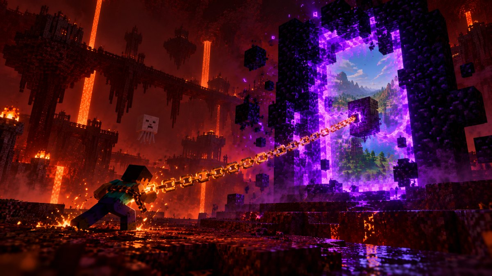

# Extreme Dimensions

*Every portal is a wound. Every wound remembers.*

A survival-horror overhaul of everything beyond the Overworld, for **Minecraft 26.3** on **Fabric**. The Nether and
the End become timed expeditions on a physical Tether; a fourth world, **the Seam**, waits behind a needle's tear; an
ancient tribe watches from the dark; four Elders, a Starved One and an ending that changes the world for good; and
after it, a tapestry you weave yourself.

---

## Getting started

1. Install **Fabric Loader 0.19.5+** for **Minecraft 26.3** (Java 25), with **Fabric API 0.162.0+**.
2. Put the mod's jar in your `mods` folder, on the server **and** on every client.
3. Play a normal Survival world. (Vanilla Hardcore makes you a spectator on death, which the mod is built to avoid.)

Your first day hands you the **Tether Journal**. Its first page, a guide card on the screen and the **Path** tab in
the journal walk you through the first expedition: charge an anchor, bind your Tether, step through, come home.

## The loop

1. **Charge an anchor.** A lodestone within 5 blocks of a portal, fed with fuel. Its first fuel binds it to that world:
   an **Ember Anchor** (Nether) or a **Void Anchor** (End). Each player stores up to 30 minutes per anchor.
2. **Bind your Tether** (iron chain + 2 string) to it. A real chain lies on the ground wherever you walk.
3. **Step through.** Your timer is the charge *you* stored, shown as a boss bar. It drains every second, faster the
   further you wander from the portal you came through.
4. **Come home** before it runs out. Or don't: at zero you suffer a **Collapse**, wake at home and pick one of three
   **curses**.

| Nether fuel | Charge | End fuel | Charge |
| --- | --- | --- | --- |
| Coal / Charcoal | 0:02 | Amethyst Shard | 0:03 |
| Magma Block | 0:06 | Chorus Fruit | 0:06 |
| Fire Charge | 0:12 | Ender Pearl | 0:20 |
| Blaze Powder | 0:15 | Eye of Ender | 0:45 |
| Coal Block | 0:18 | Shulker Shell | 1:30 |
| Breeze Rod | 0:30 | Echo Shard | 2:00 |
| **Ember Tether** | 10:00 | **Void Tether** | 10:00 |

Fuel values show in item tooltips.

## Curses, and lifting them

**92 curses in four sets**, each permanent and stacking to its own maximum: *Beyond the wound* (26, in the Nether, the
End and the Seam), *Overworld* (17, on unless an operator turns them off), *Everywhere* (16) and *Extreme* (9, cryptic,
heavy, and dearer to atone). Sometimes the offer is multiplied (2x to 4x); stacks that do not fit spill onto other
curses. Once every curse a death draws from is full, it draws from the other set, then the Extreme set, then the
Abyssal curses below. However many you carry, curses always leave you 3 hearts and 2 blocks of reach. The **Curses** screen (the button beside the journal in your inventory) shows them all.

Under the Extreme set lie the **24 Abyssal curses**, dealt on Hard and Extreme (an operator can switch them on for Easy
and Normal): one stack each, rare (at most one carried on Hard, two on Extreme, until every other curse is full), on
Extreme sometimes the only card on offer. Each has a **deed** that breaks it at
once (slay 30 undead in daylight, offer a Nether Star at an anchor, keep awake through three nights...); atonement
still works, at four times the cost, and a death takes all of it.

On **Hard** and **Extreme** a curse you have never carried shows only runes, on its card and in the Curses screen,
until you take it once; on Easy and Normal every curse reads from the start (the Extreme set only ever hints). The
runes are the **Seam script**, an alphabet of the mod's own: threads with knots, beads and loose ends tied into them.

Lift them by **atonement** (played off on expeditions and at home; every death undoes half), **Tether Fragments**
offered to an anchor, or a **Mending Cloth**. Every stack lifted leaves a **scar** that weakens the drain.

A set that is full can be **unwoven** at the world's Weaver's Loom (hold Tetherite or a Tether Cord and use the loom,
or press **Unweave** on the tapestry). The price is 2 Tetherite Ingots and 4 Tether Cords (the Extreme set half
again, and each unweaving after your first half again more). Knots of the set's colour are tied round the loom: cut
all six (six blows each) within four minutes while they lash you and the set's own creatures come in waves, and every
stack of the set comes off at once (its Abyssal curses keep their deeds). Fail and half the price comes back; after
an unweaving the loom waits three days for you.

## The worlds

- **The Nether and the End**: timed expeditions. The farther out, the faster the drain.
- **The Seam**: use a **Seam Needle** on crying obsidian. Floating islands under a sky of nebulae, colossal spires,
  Weaver looms, villages of the Thinned (who only move while you are not looking), Veil Rays overhead, and five
  minutes before you are thrown home. A monumental gate holds your rift; a compass on the bar points back to it.
  Wells at the islands' edges drop into **the Fray**, the Seam's deadlier layer, where time runs out twice as fast.
- **The Overworld**: the tribe watches. Lurkers steal and run to their **hoards**, guarded by the **Keeper**;
  Hollowlings can be befriended. After the Dragon falls, **Wound Storms** tear the sky.

## The story

Thirty pages of a nameless Wanderer surface as you play, then pages in other hands. The road runs:

1. **The first wound**: anchors, the Tether, your first Collapse.
2. **The tribe**: Lurkers, hoards, the Keeper and the Matriarch who comes for those who slay too many Keepers.
3. **The Seam** and its Weavers: silk, woven Tethers, the Thinned and the Last Weaver.
4. **The Ferryman**, who walks the Nether's lava when you are long gone.
5. **The seal**: slay the Ender Dragon and every rift opens near the **Heart of the Seam**, where the **Starved One**
   waits.
6. **The ending**: defeat it and choose. **Mend** the first wound (no storms, a gentler drain, a tribe that brings
   gifts) or **sever** the Tether (no timer beyond the wound, but whoever falls there keeps nothing).
7. **Beside the road**: the Held at the end of a warm chain, the Echoes of Collapses, and the First Weaver's trail
   through four worlds down to the First Knot and the Knot Mother.
8. **The Unfinished World** (3.0): the story goes on in your own hand.

## The Unfinished World

Once an Elder has fallen you can build a **Weaver's Loom** (4 hush pillars, 2 Seam Silk, a loom, 2 Tether Fragments).
The first one used holds the world's **tapestry**: six panels, each woven from a thread earned by a great deed, each a
lasting boon that differs between a mended and a severed world. The loom will not take a thread before the ending.

| Panel | Thread from | Mended world | Severed world |
| --- | --- | --- | --- |
| Roots | The Matriarch | Your Hollowling brings gifts twice as often | The tribe sends no Keeper after anyone |
| Toll | The Ferryman | Nether drain 10% lower | One level back on every safe return |
| Unravelling | The Last Weaver | One minute more in the Seam | The Thinned hunt only in your last sixth of Seam time |
| Chain | The Held's chamber | Anchors hold 5 minutes more | Anchors no longer turn unstable |
| Knot | The Knot Mother | Fray time runs 1.5x, not 2x | Strands give way half as often |
| Heart | The ending itself | An echo of a Collapse gives back all it cost | Once an hour, a fall beyond the wound keeps what you carried |

A lost thread can be spun back on the loom from Seam Silk by anyone whose deed it was. When the sixth panel is set,
**the Weaving** begins: for five minutes the wounds converge on your loom in waves, and every one that reaches it tears
at its ward. Hold it and the tapestry is finished; fail and the last panel unravels. A finished tapestry offers
**New Thread+**: the whole world takes up a harder thread (stronger Elders, dearer atonement, the Matriarch again, Rift
Trials past gold), and the tapestry's boons stay.

## Everything else

- **Relics** (10): bound to the Tether one at a time, each with a gift and a price.
- **Pacts**: curses taken on willingly for an expedition, for what a safe return brings.
- **Rift Trials**: a weekly goal in the Seam, a world scoreboard and medals.
- **Tetherite**: a tier past netherite. The rarest ore lies deep in the Seam's island hearts and the Fray's knots; Tether
  Fragments are spun into **Tether Cord** on a **Spindle**, and scrap and cord make the ingot. Tools, a spear and armour
  that come back from the void, and a full set that slows the drain.
- **Two armour trims**, the Weaver and the Fray, and two trim materials, Tetherite and Seam Silk, that show on every
  armour.
- **The Art of Binding**: twenty enchantments (two of them curses) for Tethers, weapons, tools and armour, most of them
  reaching into the mod's own workings (the Tether's charge, the Collapse's cards, the Lurker, the Elders' spells, the
  Seam's veins), and the Wound Lens.
- **The Elders**: the Matriarch, the Ferryman, the Last Weaver and the Knot Mother, with arenas raised by flying blocks,
  domain phases, cores that ward them and islands that fall.
- **The tribe as a faction**: standing from hunted to kin, barter, raids.
- **The wounds remember**: Echoes, Unstable Anchors, Unanchored builds and Frayed islands.
- **Co-op**: fallen players can be revived, curses carried for a friend, anchors shared. Every player has their own
  time.
- **55 advancements**, the recipe book through them, a bestiary and a ledger in the journal.
- **A music disc**: *Tick of the Boundary* on a record of its own, now and then in a barrel of the Thinned in the Seam
  (the richer the barrel, the likelier); it plays in any jukebox.
- **Title and loading screens**: the picture of the Tether, with its own music (*Tick of the Boundary* on the menus,
  *Ominous Loading Screen* while a world loads, until you stand in it). Under Display it can be the art only, the
  music only, or Minecraft's own.

## Compatibility

Built for vanilla 26.3 with Fabric API. CI runs the client with the newest **Sodium**, **Iris** and **Mod Menu** for
the game version on every push; with Mod Menu installed, the mod's settings open from its Configure button.

## Configuration

Every value lives in `config/extremedimensions.json` (written on first launch) and in the in-game settings screen,
grouped by system, with a name and a description in every language; operators change the server's values from the
screen. Four difficulties set many at once: **Easy**, **Normal** (the default), **Hard** and **Extreme**, also with
`/tether preset <name>`. Curses have their own `penalties` section.

## Datapacks

The mod's loot (the Elders' spoils, hoards, the Wanderer's leavings in structures) is in loot tables under
`data/extremedimensions/loot_table/`; the Seam's island mix, sizes and land shapes in
`data/extremedimensions/seam/briefs.json`; recipes, advancements, enchantments and the music disc's song
(`data/extremedimensions/jukebox_song/`) are data as well. A datapack can replace any of them (on `/reload` too).

## Languages

English and Dutch, complete. Every text goes through `assets/extremedimensions/lang/`; a translation is checked
against English at build time (same keys, same placeholders).

## Building and testing

```
./gradlew build            # the jar, in build/libs/
./gradlew runGameTest      # the server game tests
./gradlew runClientGameTest   # the client test (needs a display), with screenshots
```

CI builds every push, runs the server tests, the client test with its screenshots, and the compatibility run; the jar
is in the run's **Artifacts**. When `version` in `gradle.properties` is new and all of that passes on the default or the
development branch, CI publishes it as GitHub release `v<version>`, with that version's part of the changelog as notes.

The server tests run side by side in batches. A test that wakes an Elder (or otherwise reaches past its own walls)
gets an environment of its own from `Alone` in the test sources, so it runs in a batch by itself.

The performance tests (`PerfTests`) log a `PERF` line each: the Seam's building, curses, bindings and echoes, and a
fight with each Elder at its arena's full size. A fight's line gives the mod's tick by the clock and in CPU time, the
worst tick of each part of it (`TickProfile`) and the garbage collection in those ticks; a part that runs past 40 ms
also logs where the server thread stood, so a tick slow by the clock but not in CPU time shows what it waited on. The
tests judge the mod by its CPU time, and fail a fight in which the mod waited on a chunk to load.

What the mod costs a server, set against the same server without it, is the benchmark's to say (CI job *performance with
and without the mod*; the table is on the run's summary page). `tools/bench/run.py` runs a real Fabric dedicated server
on a fresh world from one seed, in turn without the mod and with it (Fabric API both times), twice each, and a little
mod of its own (`src/bench`, never shipped, built by `./gradlew benchJar`) takes it through the same play: the server
alone, four players standing about, the players sprinting outwards over new land, and with the mod the players in the
Seam. Per phase: MSPT, the server thread's and every thread's CPU time, memory, entities, and where the server thread
stood in any tick over 100 ms. To run it yourself: `./gradlew assemble benchJar` and `python3 tools/bench/run.py <dir>`
(Java 25 on the path; it fetches the Fabric server and Fabric API).

## Project layout

| Package | What lives there |
| --- | --- |
| `anchor`, `expedition`, `tether` | Anchors and fuel; entering, draining and the Collapse; the chain on the ground |
| `penalty`, `pact`, `relic`, `binding` | Curses and atonement; pacts; relics; enchantments |
| `seam` | The Seam: its architecture, terrain, ruins, fauna, the Fray, gates and rifts |
| `elder`, `mending` | The Elders and their arenas; the Heart and the Starved One |
| `lurker`, `hollow`, `tribe` | The tribe: Lurkers, hoards and Hollowlings, standing and barter |
| `events`, `world` | The wounds remember; Wound Storms and the seal |
| `lore`, `journal`, `guide` | The Wanderer's leavings, the warm chain and the First Weaver; the journal; the Path and hints |
| `tapestry` | The Weaver's Loom, its panels and boons, the Weaving and New Thread+ |
| `trial`, `coop`, `progression` | Rift Trials; co-op; advancements |
| `data`, `config`, `network` | World data, the settings, payloads |
| `client` | HUD, screens, sky and fog, models, sounds, tooltips |

---

### Nederlands, kort

Download de jar uit de nieuwste groene build (**Actions** → run → **Artifacts**) en zet hem met Fabric API in je
`mods`-map, op de server én bij iedere speler. Alles is in het Nederlands te spelen. Instellingen staan in het
instellingenscherm en in `config/extremedimensions.json`. Na het einde bouw je een **Weversgetouw** en weef je het
wandtapijt: zes panelen, elk een blijvende gunst, en daarna Nieuwe Draad+. Een volle vloekset **ontweef** je aan het
getouw met Tetheriet en Tetherkoord: hak de knopen op tijd door en de hele set gaat eraf. Diep in de Seam ligt **Tetheriet**: spin
Tether Fragments op een **Spinrok** tot Tetherkoord, smeed het tot een rang voorbij netheriet, en kies uit twintig
betoveringen en twee nieuwe harnasversieringen.

## License

CC0-1.0
